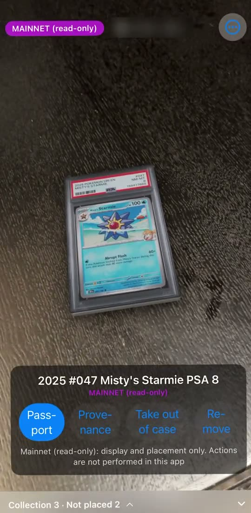

# Collectibles AR

**Collectibles AR is the AR layer for real cards on Solana. Pull a pack, and the graded card appears life-size in the room you're in.**

Gacha runs on Collector Crypt's machines hosted in-app; Collectibles AR owns the summon, the display, and the shot. Revenue is the per-pack fee on hosted machines.

[](https://collectiblesar.com)

Live site: [collectiblesar.com](https://collectiblesar.com) · Built for [Crypto World's Fair 2026](https://colosseum.com/worldsfair) (Colosseum, Sept 14 – Oct 12, 2026)

> Solana solved moving ownership: you can trade a real card without shipping it. Collectibles AR solves showing it off without shipping it.

The card appears where you are, the moment you pull it. The physical card stays in Collector Crypt's vault. Sell it back and it leaves your room.

## Why

Real graded cards on Solana are already a large category: Collector Crypt, Phygitals, Jupiter Gacha, Solflare Packs, Rarible Gacha Station and ONE Arena are all active in it. Products stand apart by what happens after the pull, such as binders, game worlds and battles. We have not found one that puts the card in your physical space with AR. Collectibles AR takes that spot.

The product has two pillars:

| | Pillar 1: Opening | Pillar 2: Placing |
|---|---|---|
| Experience | The rush of the pull | Lining cards up, looking at them, showing them off |
| Time | Once, tens of seconds | You keep coming back |
| Where | Web | iOS app (connect a wallet you already have) |
| Money | Moves (per-pack fee on the machine) | Does not move |
| Exit | Share | Share |

People who see a share enter through pillar 1. People who already own cards can enter through pillar 2.

Only the iOS app claims life-size. The Web shows the card through your camera, without plane detection or true scale.

## What works

| Flow | Network | Status |
|---|---|---|
| Web: connect Phantom → view the `pokemon_25` machine → Pull (sign with Phantom) → open → My Collection | devnet | Completed with real data (first real pull 2026-10-06) |
| Web: capsule opening, card revealed through the camera, export the shot to share | devnet | Implemented |
| iPhone: "Link wallet" in the app → sign in on the Web inside Phantom's browser → back to the app | n/a | Verified on device (iPhone 13 Pro, 2026-10-09) |
| iPhone AR: real cards from your own wallet shown as `MAINNET (read-only)` and placed on a wall and a desk at graded-slab size | mainnet, read-only | Verified on device with three real cards (2026-10-09) |
| iPhone AR: place several cards, select, remove, re-place; "Take out of case" to show the card alone | n/a | Verified on device (2026-10-09) |
| iPhone AR: a card pulled on the Web appears on the linked iPhone (Appear) | devnet | Implemented, not yet verified end to end on device |
| iPhone AR: Passport (onchain facts, third-party claims, Collectibles AR interpretation shown separately) | devnet, mainnet read-only | Implemented, not yet verified on device |
| Sell back to Collector Crypt → the card leaves the room (Disappear) | devnet | Implemented, not yet verified on device |
| Apple Vision Pro hero demo | n/a | Early prototype on demo data (P1) |

Not done: three consecutive end-to-end runs on device, placing on the floor, background/foreground recovery.

The public site at collectiblesar.com is the landing page. Pull and Collection are marked "Soon" there; the full devnet flow runs from a local build (see below).

All signing happens on the Web with Phantom. The iPhone holds no keys and only shows the result. The app never performs a Pull, a buyback or a transfer on mainnet. Real packs are pulled on [gacha.collectorcrypt.com](https://gacha.collectorcrypt.com).

## Labels

Every screen says where its data comes from.

| Label | Meaning |
|---|---|
| `DEMO DATA` | Fixtures: dummy cards drawn for this project. No real card images |
| `DEVNET` | Live Solana devnet. A devnet Pull is not revenue |
| `MAINNET (read-only)` | Real cards in your own wallet, read only |

## How it uses Solana

- **Collector Crypt Gacha API**: machine info, `generatePack` → sign → `submitTransaction` → `openPack`, idempotent by memo, buyback, and a link to the VRF verification page for each pull
- **Helius RPC and DAS**: reads the card assets in a wallet (Metaplex Core, pNFT) and normalizes them into one shared model. An asset counts as Collector Crypt issued only when its collection address matches
- **Phantom**: wallet sign-in and transaction signing on the Web; its in-app browser carries the wallet link to the iPhone
- **Metaplex Core**: devnet mint and transfer scripts under `scripts/solana` (used by the earlier prototype)

## Stack

| Client | Role | Priority |
|---|---|---|
| iPhone AR (SwiftUI, RealityKit, ARKit) | Appear, Place, Passport, Disappear | P0 |
| Web (Next.js 16, React 19, TypeScript) | Wallet sign-in and signing, machines, Pull and opening, My Collection, buyback | P0 |
| Apple Vision Pro (SwiftUI, RealityKit) | Hero demo showing the same assets | P1 |

iOS and visionOS share one Swift package (`packages/TwinfoldCore`) for the common model, the providers and the spatial entities.

The UI never calls Solana RPC, DAS or the Collector Crypt API directly. It goes through `AssetProvider` (Mock / Solana) and `GachaProvider` (Mock / CollectorCrypt), and both implementations return the same model. See [docs/architecture.md](docs/architecture.md) (Japanese).

## Collector Crypt and what we are responsible for

- Inventory, vault storage, shipping, buyback and the legal side belong to Collector Crypt. Collectibles AR holds no physical cards
- Machine price, odds, EV, stock and buyback rate are shown exactly as returned by Collector Crypt's `/api/machines`. Collectibles AR does not calculate or adjust them and does not stand behind them
- Buyback is done by Collector Crypt (within 72 hours, at the rate set per machine)
- The PSA grade, `Authenticated`, Insured Value and the vault record are claims by Collector Crypt or the grading company. Collectibles AR has not verified them
- The Passport separates onchain facts (owner, mint, transfer), third-party claims, and Collectibles AR interpretation. The blockchain, the NFT and the Passport do not prove a card is authentic or describe its physical condition after shipping
- Funds never pass through Collectibles AR. The user signs the Collector Crypt transaction with their own wallet
- The revenue line is a plan based on Collector Crypt's `can_adopt` feature: your own machine code on an existing machine, with a fee of up to 10% per pack. Our API key and `can_adopt` request is pending and has not been approved. Payouts would be made by Collector Crypt
- Viewing machines, Pull and opening all work without a Collector Crypt API key

## Disclaimer

Odds, EV, stock and buyback rates are figures published by Collector Crypt. Nothing here promises a win, a profit or a return. A devnet Pull is not revenue. The app does not perform mainnet payments or physical shipping.

Pokémon and the names of other card games belong to their owners. Collectibles AR is an independent project and is not affiliated with them, with PSA, CGC or Collector Crypt.

## Run it

### Web

```bash
cd apps/web
npm install
cp .env.example .env.local
npm run dev
```

Open `http://localhost:3000`.

Machines, Pull and opening talk to Collector Crypt's devnet API by default and need no key. For the full devnet flow, set these in `.env.local` (`.env.example` documents each one):

| Variable | Purpose |
|---|---|
| `HELIUS_API_KEY` | Reading wallet assets. Server side only |
| `TWINFOLD_SESSION_SECRET` | Signs the wallet session cookie. Generate with `openssl rand -base64 32` |
| `COLLECTOR_CRYPT_COLLECTION_ADDRESSES_DEVNET` | Collections that count as Collector Crypt issued. The values are in `.env.example` |
| `COLLECTOR_CRYPT_COLLECTION_ADDRESSES_MAINNET` | Same, for the read-only mainnet view |
| `NEXT_PUBLIC_PULL_OPEN=1` | Turns the Pull buttons on. Unset, they show "Opening soon" |

A devnet Pull needs a Phantom wallet set to devnet with devnet SOL and devnet USDC ([faucet](https://spl-token-faucet.com/?token-name=USDC-Dev), mint `Gh9ZwEmdLJ8DscKNTkTqPbNwLNNBjuSzaG9Vp2KGtKJr`). No Collector Crypt API key is needed. `GACHA_PROVIDER=mock` serves every gacha route from demo data.

Checks:

```bash
npm run build
```

```bash
npm run lint
```

```bash
npm run test:gacha
```

### iPhone AR

Requires Xcode, [XcodeGen](https://github.com/yonaskolb/XcodeGen) and an iPhone on iOS 17 or later. AR needs a real device.

```bash
cd apps/ios
xcodegen generate
open TwinfoldAR.xcodeproj
```

Before building, edit two values in `apps/ios/project.yml`:

- `TWINFOLD_API_BASE_URL`: where the iPhone reaches the Web app, for example `http://<your Mac's LAN address>:3000`
- `TWINFOLD_WEB_URL`: a public `https` address for the same Web app (a tunnel works). Phantom's browser opens this one for the wallet link

Select your own signing team in Xcode and run on the device.

### Shared Swift package

```bash
cd packages/TwinfoldCore
swift build
```

### Vision Pro

See [apps/visionos/README.md](apps/visionos/README.md) (Japanese).

## Repository layout

```text
apps/
  web/       Next.js Web (machines, Pull, My Collection, buyback, device link, landing)
  ios/       iPhone AR: SwiftUI + RealityKit + ARKit (P0)
  visionos/  SwiftUI + RealityKit prototype (P1)
packages/
  TwinfoldCore/  Shared model, providers and spatial entities for iOS and visionOS
fixtures/    Demo data shared by the Web and the Swift package
scripts/     Devnet mint/transfer tooling and fixture sync
docs/        Architecture (Japanese)
```

The product is called Collectibles AR. The Swift package and type names (`TwinfoldCore`, `TwinfoldAsset`), API paths, fixture ids and environment variables keep the earlier name, Twinfold.

No private keys, API keys or personal data are stored in this repository. Card images are loaded at runtime from the URLs in each asset's metadata and are not committed. The one exception is the two screen recordings of the running app used on the landing page (`apps/web/public/lp/`).

This is the public copy of a private working repository. Internal planning documents and the instructions for AI coding agents (`AGENTS.md`, `docs/mvp.md`, `docs/build-order.md`) were left out of it, including from the history, so some code comments point to files that are not here. `docs/architecture.md` is a working document written in Japanese during the build.

## Prior work and the pivot

This repository contains work from before and during the hackathon. The git history separates the periods.

- **Before Sept 14, 2026**: business documents, a Web UI prototype and a visionOS prototype
- **Sept 21 – Oct 6**: an AR collection for ukiyo-e woodblock prints hung on a wall (renamed OshiPin on Oct 5)
- **Oct 6**: pivoted to showing Collector Crypt's real graded cards in AR, first as SlabAR, renamed Collectibles AR on Oct 7

The iPhone link, the wallet signing and the AR placement built for the print version are reused in the current product. The ukiyo-e and kokeshi fixtures, the redeem dry run and the earlier buyback and vault code remain in the repository but are dormant and are not part of Collectibles AR.
