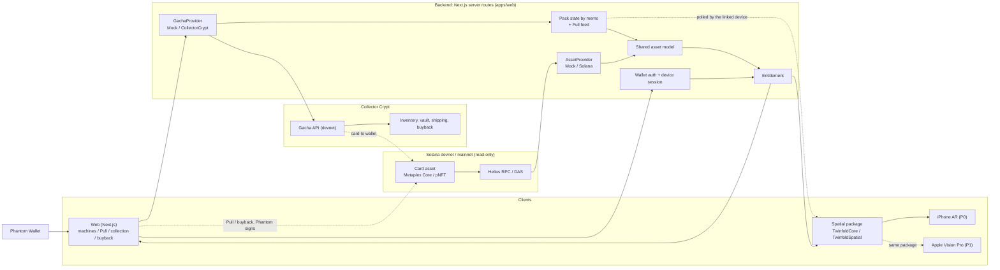
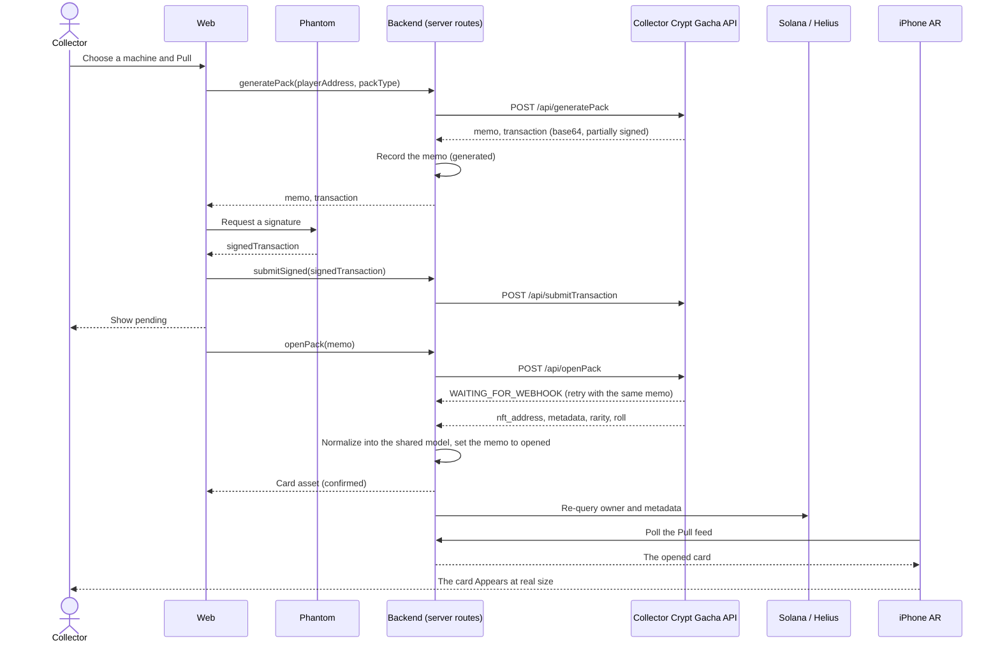

# Collectibles AR Technical Architecture

This document describes how Collectibles AR is built today: who is responsible for what, the shared data model, how a Pull reaches the iPhone, and the safety rules. For what has been verified on a device and what has not, see the status table in the [README](../README.md).

The product is called Collectibles AR. Code names (`TwinfoldCore`, `TwinfoldAsset`, the `twinfold://` scheme, environment variables) keep the earlier name, Twinfold.

## 1. Goal

Take real card assets on Solana (issued by Collector Crypt), convert them into one shared model, show them at real size in physical space the moment they are pulled, and remove them when they are sold back.

```text
Choose a machine → Pull (sign on the Web) → open
→ normalize the Collector Crypt card asset into the shared model
→ Appear in the space of the linked iPhone → Place / Passport
→ buyback (Collector Crypt) → Disappear
```

- Signing happens only on the Web, with Phantom. The iPhone holds no keys and shows the result.
- Inventory, vault storage, shipping and buyback belong to Collector Crypt. Collectibles AR holds no physical cards.
- Funds never pass through Collectibles AR. The user signs Collector Crypt's transaction with their own wallet.
- The app writes only on devnet. Mainnet is read only.

## 2. System overview



| Part | Where | Role |
|---|---|---|
| Web | `apps/web` (Next.js 16, React 19, TypeScript) | Wallet sign-in and signing, machines, Pull and opening, My Collection, buyback, device link, landing page |
| Backend | Server routes in `apps/web/app/api` | The only code that calls Collector Crypt and Helius. Auth, sessions, pack state, normalization, entitlement |
| Shared Swift package | `packages/TwinfoldCore` | `TwinfoldCore`: model, providers, link client. `TwinfoldSpatial`: RealityKit entities for the slab and the card |
| iPhone AR | `apps/ios` (SwiftUI, RealityKit, ARKit) | The ARKit adapter: camera, plane detection, anchors, touch. Appear, Place, Passport, Disappear |
| Apple Vision Pro | `apps/visionos` | Early prototype on demo data, using the same package |

Local state such as pack records is kept in JSON files under `apps/web/.data/`, which is not committed. There is no production database yet.

## 3. Boundaries

These rules hold across the codebase.

- **The UI never calls Solana RPC, DAS or the Collector Crypt API directly.** Web components and the Swift clients go through `AssetProvider` and `GachaProvider`, and those reach the outside world only through the server routes.
- **Mock and live providers return the same model.** `MockAssetProvider` / `SolanaAssetProvider` and `MockGachaProvider` / `CollectorCryptGachaProvider` implement the same interfaces, so every screen runs on fixtures or on a live connection.
- **Every screen says where its data comes from**: `DEMO DATA` for fixtures, `DEVNET` for live devnet, `MAINNET (read-only)` for real cards in the user's wallet.
- **Platform code is isolated.** ARKit lives in the iOS adapter. The spatial package interprets only the shared model and does no purchasing, key handling or signing.
- **Collector Crypt's numbers are shown unchanged.** Price, odds, EV, stock and buyback rate come from `/api/machines` and are never calculated or adjusted by us.
- **Writes are idempotent** by Pull memo or transaction signature, and distinguish `pending`, `confirmed` and `failed`.

## 4. Flows

### 4.1 Sign-in and device link

```text
Connect Phantom on the Web
→ the server issues a nonce with an expiry
→ the user signs a login message (domain, purpose, nonce, expiry) with Phantom
→ the server verifies the signature and issues a short-lived Web session
→ the Web issues a one-time link code (valid for 2 minutes)
→ the iPhone exchanges the code for a device token
→ the server returns only the assets that wallet may display
```

- Phantom's private key is never stored on the Web, the server or the iPhone.
- Typing a wallet address alone does not enable owner features.
- The device token is specific to the device and can be revoked individually. It can read state and create requests. It cannot sign.

The link can start from the iPhone: "Link wallet" in the app opens the Web's `/link` page inside Phantom's in-app browser through Phantom's browse deeplink. `/link` signs in, issues a code and returns to the app through `twinfold://link?code=`. This route exists because only Phantom's in-app browser provides `window.phantom` on iPhone. If the automatic return fails, the page offers a button, and then the 8-character code to type by hand.

### 4.2 Pull and open



- Nothing is shown as won until `openPack` returns.
- The memo is the idempotency key. Resending the same memo returns the same card and never opens twice.
- Before signing, the Web shows the machine, the price, the network and the purpose of the transaction.
- The Play endpoints work without a Collector Crypt API key. A key only adds our slug to the memo.

On the Web, the opening is shown as a capsule that opens and reveals the card through the camera, and the shot can be exported to share. Because the Pull is signed inside the Phantom app, whose browser cannot use the camera, `/pull/reveal` can replay the opening in Safari from the card's public address alone. The Web does not claim real size or plane anchoring.

### 4.3 Appear, Place and Passport on iPhone

```text
The linked iPhone polls the Pull feed (GET /api/gacha/packs) with its device token
→ the server checks the token, the chain owner and the asset state
→ it returns the shared asset model and the entitlement
→ the image is fetched at runtime from the URL in the asset's metadata
→ the card Appears at graded-slab size on a detected plane
→ the collector places several cards, and taps one to open its Passport
```

- The slab is rendered 1:1. Scale is never adjusted.
- Collector Crypt's image is a photograph of the whole slab, so it is applied unlit to the front face at real size. We do not draw our own label or text.
- On a wall the slab sits flush. On a desk it lies flat. "Take out of case" crops the card from the slab photograph and shows it alone at 63 × 88 mm.
- Placements are registered as ARKit anchors. Lighting follows the room's ambient light, with a contact shadow.
- The same memo and the same asset never Appear twice.

The Passport shows three sections and never merges them into one "verified" label.

| Section | Content | Examples |
|---|---|---|
| Onchain fact | What can be checked on chain | Mint address, owner, transfer and Pull signatures, Pull memo |
| Third-party claim | What PSA, CGC or Collector Crypt states | Grade and certificate number, `Authenticated`, Insured Value, Vault and Vault ID. Never described as verified by Collectibles AR |
| Collectibles AR interpretation | Formatting by Collectibles AR for display | The display name, notes such as "according to Collector Crypt's record" |

The Passport links to PSA's certificate lookup for PSA-graded cards and to Collector Crypt's VRF verification page for the Pull. Neither the blockchain, the NFT nor the Passport proves that a card is authentic or describes its physical condition after shipping.

### 4.4 Buyback and Disappear

```text
The Web asks whether a buyback is available and shows the amount and the time remaining
→ it states that the buyback is made by Collector Crypt, within 72 hours, at the rate set per machine
→ the user signs the buyback transaction with Phantom
→ Web and iPhone show pending
→ after the transaction is confirmed on chain, the server re-evaluates owner and entitlement
→ the previous owner's entitlement becomes false and the placement is invalidated
→ the card Disappears from the room
```

- If signing or the transaction fails, the owner and the placement are kept, and `failed` is shown with a way to retry.
- The card is never removed from the room before the chain confirms.

### 4.5 Mainnet, read only

```text
Link a wallet that holds real Collector Crypt cards
→ the server reads that wallet's assets through Helius mainnet DAS
→ only assets whose collection address is configured as Collector Crypt's are returned
→ they are shown as MAINNET (read-only), in My Collection and in AR
```

- The app does not Pull, buy back or transfer on mainnet. Every write route answers 400 to a mainnet request, and the gacha provider refuses any host other than Collector Crypt's devnet (a localhost stub is accepted outside production).
- Mainnet and devnet are never mixed in a list, in credentials or in settings.
- A card that only has the right-looking attributes, without a matching collection, is marked `UNVERIFIED SOURCE` and kept out of AR.

### 4.6 Delays and failures

| Situation | Handling |
|---|---|
| `openPack` returns `WAITING_FOR_WEBHOOK` | Retry with the same memo after about a second. Past the retry limit, stay pending and check `/api/gacha/pack/status` |
| The pack was not opened within 2 hours | Treated as expired. The user is asked to Pull again |
| 429 or 503 from Collector Crypt | Retried with backoff and shown as busy, not as a failure |
| Failure after signing | `openPack` is retried with the same memo. A new pack is never generated on the user's behalf |
| Chain state and local state disagree | Stay pending and re-query. If it persists, stop displaying the asset |

Caches speed up display but are never the source of truth for ownership.

## 5. Shared model

The TypeScript definitions in `apps/web/lib/contract.ts` are the source of truth. The Swift package mirrors them.

```ts
type TwinfoldAsset = {
  id: string;                     // stable internal id
  network: "devnet" | "mainnet";
  address: string;                // onchain address
  standard: string;               // Core, pNFT, ...
  owner: string | null;
  title: string;
  display: DisplayDescriptor;
  provenance: ProvenanceEvent[];
  // Card fields
  category?: "card";
  grade?: string;                 // e.g. "GEM-MT 10" (third-party claim)
  gradingCompany?: string;        // e.g. "PSA"
  gradingId?: string;
  insuredValueUsd?: number;       // Collector Crypt's insured value (third-party claim)
  vault?: string;
  vaultId?: string;
  gachaMemo?: string;             // set when the card came from a Pull
  imageUrl?: string;              // from the metadata, read at runtime
  source?: "collectorCrypt";      // set only for a card opened through this app or matching a configured collection address
  sourceVerified?: boolean;       // false = UNVERIFIED SOURCE, excluded from AR
  physical?: PhysicalDescriptor;  // dormant, from the earlier redeem flow
};

type ProvenanceEvent = {
  id: string;
  assetId: string;
  kind: ProvenanceKind;           // "minted" | "transferred" for cards
  occurredAt: string;
  source: "onchain" | "offchain_evidence" | "twinfold_interpretation";
  status: "pending" | "confirmed" | "failed";
  transaction?: string;
  slot?: number;
  evidenceHash?: string;
  metadata: Record<string, unknown>;
};

type Entitlement = {
  wallet: string;
  assetId: string;
  canDisplay: boolean;
  reason: string;
  checkedAt: string;
};
```

`ProvenanceEvent.source` maps to the three Passport sections: `onchain` is an onchain fact, `offchain_evidence` is a third-party claim with its origin kept in `metadata`, and `twinfold_interpretation` is Collectibles AR's own formatting.

The mapping from a Collector Crypt card's attributes (`Grading Company`, `The Grade`, `Grading ID`, `Insured Value`, `Vault`, `Vault ID`) to these fields is in `apps/web/lib/gacha/normalize.ts`. A missing attribute is never filled in by guessing.

## 6. Providers

```ts
interface AssetProvider {
  readonly isDemoData: boolean;
  getAssets(wallet: string): Promise<TwinfoldAsset[]>;
  getAsset(assetId: string): Promise<TwinfoldAsset>;
  refreshOwnership(assetId: string): Promise<Entitlement>;
}

interface GachaProvider {
  readonly isDemoData: boolean;
  listMachines(): Promise<Machine[]>;
  generatePack(input: { playerAddress: string; packType: string; turbo?: boolean }): Promise<{ memo: string; transaction: string }>;
  submitSigned(signedTransaction: string): Promise<{ signature: string }>;
  openPack(memo: string): Promise<OpenedPack>;
  buybackAvailable(nft: string): Promise<{ available: boolean; amount: string; timeRemaining: number }>;
  buildBuyback(input: { playerAddress: string; nftAddress: string }): Promise<{ serializedTransaction: string }>;
}
```

- `MockAssetProvider` and `MockGachaProvider` return fixtures: dummy cards drawn for this project, labeled `DEMO DATA`. `GACHA_PROVIDER=mock` serves every gacha route from them, which also keeps the screens usable when Collector Crypt's devnet API is down.
- `SolanaAssetProvider` reads assets through Helius DAS and returns the same type.
- `CollectorCryptGachaProvider` runs on the server and calls `https://dev-gacha.collectorcrypt.com`.

## 7. Entitlement

```text
canDisplay =
  authenticated session
  AND chain owner matches wallet
  AND asset is active
  AND asset is not in exception
```

Entitlement is never granted from a cached owner alone. When the owner changes, the previous owner's saved placements are invalidated. A card image already downloaded to a device cannot be recalled; this is a known limitation.

## 8. Security

- `HELIUS_API_KEY` and `COLLECTOR_CRYPT_API_KEY` are read only on the server and are never exposed as `NEXT_PUBLIC_`.
- Personal data, private keys and the full text of signed transactions are never logged.
- Nonces are single-use, and signed login messages cannot be replayed.
- The server never signs with a user's key. The user signs the transaction that Collector Crypt has partially signed.
- Exactly one pack state is kept per memo, so a resend is not processed twice.
- Card images are not committed. They are read at runtime from the URL in each asset's metadata.

## 9. Not built

- Pull, buyback or transfers on mainnet inside the app
- Our own inventory, vault, shipping or buyback
- Trading between users, a marketplace, auctions
- Receiving fees: the per-pack fee depends on Collector Crypt enabling `can_adopt` for us, which is requested and not approved
- A production database and production hosting for the backend
- Card categories other than Pokémon
- Production builds for Vision Pro, Meta Quest or Android

The repository also contains code from the earlier ukiyo-e print version (reference assets, a redeem dry run, a buyback offer, server-signed devnet transfers). It is dormant and is not called from the card flows.
