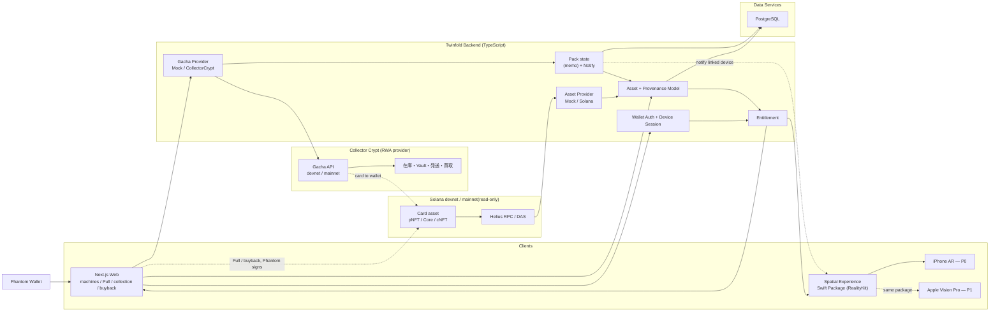
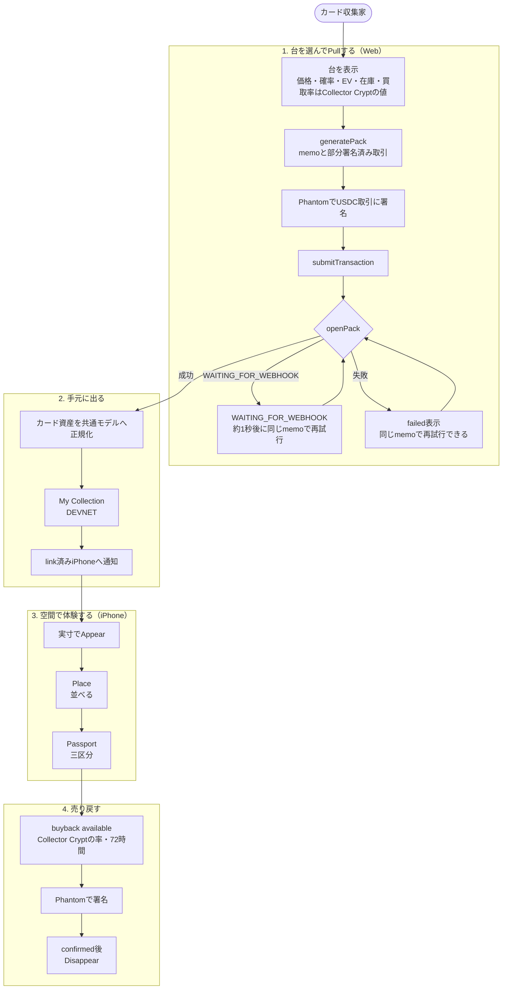
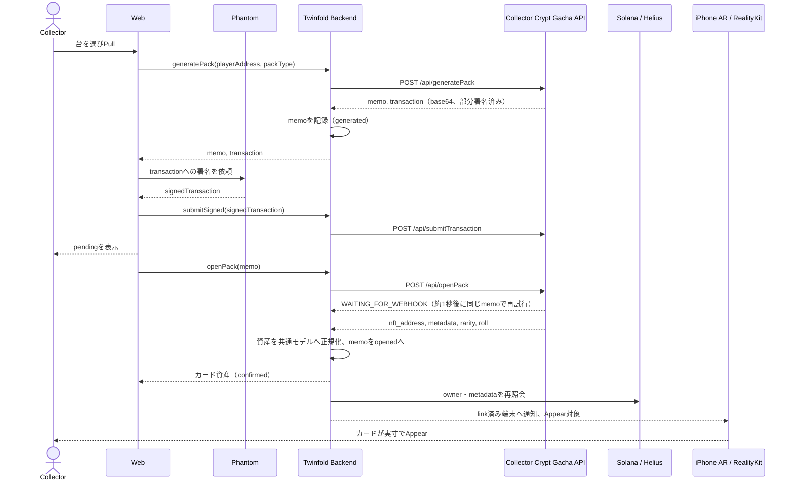

# Collectibles AR Technical Architecture

> ステータス: Colosseum MVP技術ベースライン
> 最終更新: 2026-10-07（Collectibles ARに改名。2026-10-06にSlabARとして転換した内容のまま、名称のみ更新。Collector Cryptの実物カードをARで出す構成に全面書き換え）。前回 2026-10-05（OshiPin）
>
> beachhead変更履歴: アニメ原画（〜2026-09-11）→ 切手（2026-09-11〜2026-09-21）→ 棚に飾るコレクティブル（2026-09-21）→ 壁に掛ける浮世絵・版画（2026-09-21〜2026-10-06、10/05にOshiPin改名）→ **Collector Cryptの実物ポケカをARで出すCollectibles AR（2026-10-06にSlabARとして決定、2026-10-07に改名）**。浮世絵、自前Vault、Twinfold buyback offer、redeem escrow、こけしは履歴で、コードとfixtureは休眠として残る。

この文書は、MVPの責務境界、共通データ、同期、安全性の技術ベースラインを定義する。合格基準は [MVP Acceptance Criteria](./mvp.md)、実装順と日程は [Build Order](./build-order.md) を正とする。共通型の実体は散文ではなくコード（`apps/web` 側の共有型定義）を正とし、この文書は形・不変条件・境界だけを示す。E2Eフローと契約の詳細を二重管理しないため、Development Plan からはこの文書を参照する。Collector Crypt APIの詳細は `.claude/skills/collector-crypt-gacha` を参照する。

## 1. 技術目標

Solana上の実物カード資産（Collector Crypt）を共通モデルへ変換し、引いた瞬間に現実空間へ実寸で出し、売り戻したら消えるまでを体験できるようにする。

```text
台を選ぶ → Pull（Webで署名）→ 開封
→ Collector Crypt由来のカード資産を共通モデルへ正規化
→ link済みiPhoneの空間へAppear → Place／Passport
→ 買取（Collector Crypt）→ Disappear
```

- 署名はWeb（Phantom）だけ。結果はlink済みiPhoneのARに出る。
- 在庫・Vault保管・発送・買取はCollector Cryptが担う。Collectibles ARは現物を持たない。
- 収益はホストした台の手数料（Collector Cryptの `can_adopt` による自分の台コード。承認待ちで、提出時は仕組みの提示まで）。

Spatial ClientはSwiftUI + RealityKitを共通実装（Swift Package `TwinfoldCore`／`TwinfoldSpatial`）とし、MVPのPrimary ClientはiPhone ARとする。ARKitなどplatform固有処理は `apps/ios` のAdapterへ隔離し、Apple Vision Pro（`apps/visionos`）は同じPackageを使うHero／secondary clientとして扱う。2026-09-18にUnity + AR FoundationからSwiftUI + RealityKitへ切り替えた。

- P0: SwiftUI + RealityKit + ARKit（iPhone、`apps/ios`）
- P1: 同じSwift Packageを使うvisionOS app（`apps/visionos`）+ Apple Vision Pro
- Post-MVP: Meta Quest、Android（UnityかWebXRかはその時点で再検討）

Post-MVP対応のための共通化で、iPhoneのPrimary E2Eを遅らせない。

## 2. システム全体像

コンポーネントと主要なデータフローだけを示す。各要素の決定・準備状況は下の「サービス選定状況」を正とし、図には重複させない。



### 2.1 フロー別の動き

各フローでは「入口」「Backendで行うこと」「外部サービス」「完了状態」を分けて考える。

#### End-to-Endフロー図



図の読み方:

- **Pull**はWeb、Collector Crypt、Phantomを通り、openPackが返るまで「当たった」と表示しない。
- **手元に出る**は共通モデルへの正規化と通知。Spatial ClientからCollector CryptやSolanaを直接呼ばない。
- **空間体験**はBackendが返すEntitlementと共通モデルだけを使う。
- **売り戻す**はCollector Cryptの買取で、chainでconfirmedになった後にだけDisappearする。

#### Pull／開封のシーケンス



#### A. 初回利用と端末連携

```text
WebでPhantomを接続
→ Backendがnonceを発行
→ Phantomでログイン用messageへ署名
→ Backendが署名を検証しWeb sessionを発行
→ Webが一回限りのlink codeを発行
→ iPhone ARがcodeをBackendと交換
→ 端末用sessionを発行
→ そのwalletに表示権があるAssetだけを返す
```

- Phantomの秘密鍵はWeb、Backend、iPhoneへ保存しない。
- wallet addressを入力しただけでは所有者向け機能を有効にしない。
- link codeは短時間・一回限りとし、端末sessionは個別に失効できるようにする。
- 入口はiPhone側にもある（2026-10-09）: アプリの「walletを連携」→「Phantomで連携」が、Phantomの browse deeplink でPhantom内蔵ブラウザにWebの `/link` を開く。`/link` はサインイン→code発行→`twinfold://link?code=` でアプリへ戻る（自動復帰、ボタン、8文字手入力の順に後退）。iPhoneにはPhantomのブラウザ拡張が無く、`window.phantom` を注入できるのはPhantom内蔵ブラウザだけなので、自前WebViewでは成立しない。Phantom `connect` deeplinkによる直接接続（NaCl boxの復号が必要）は提出後。
- Demoモードから連携した場合は `MAINNET (read-only)` に切り替えて、自分のwalletの本物のカードをすぐ出す。

#### B. 台の表示とPull／開封（Collector Crypt）

```text
Webが台の一覧を要求（GachaProvider.listMachines）
→ Backendが GET /api/machines を呼ぶ
→ 価格・確率・EV・在庫・買取率を「Collector Cryptの値」としてそのまま表示（自前で計算しない）
→ ユーザーが台（既定 pokemon_25）を選びPull
→ POST /api/generatePack {playerAddress, packType, turbo?, altPlayerAddress?}
   → {memo, transaction}（base64、部分署名済み。USDCをgacha walletへ送る）
→ Backendがmemoを `generated` として記録（冪等キー）
→ ユーザーがPhantomで署名
→ POST /api/submitTransaction {signedTransaction}
→ POST /api/openPack {memo}
   → {nft_address, transactionSignature, nftWon.content.metadata{name, attributes}, rarity, roll}
→ カード資産を共通モデルへ正規化し、memoを `opened` として記録
→ My Collectionに表示（DEVNET）
```

- `x-api-key` を付けるとmemoに自分のslugが付き、`/api/getWinners?slug=` やAblyのlive winnersで自分経由の引きを識別できる。keyが無くてもPlay系endpointは動く。
- 開封期限は発行から2時間。同じmemoの再送は同じ結果を返す（冪等）。
- Webは署名前に、対象の台、価格、network、transactionの目的を表示する。「必ず当たる」「保証」「投資」「儲かる」と書かない。確率・EV・買取率にはCollector Cryptの公表値であり、Collectibles ARが保証するものではないと併記する。
- devnetのPullを売上と呼ばない。
- Invoiced API（`/api/v1`、自前決済のパートナー向け）はP0では使わない。

#### C. link済みiPhoneへのAppear

```text
openPackが成功しカード資産が共通モデルへ正規化される
→ Backendが、そのwalletのlink済み端末sessionへ通知（既存のiPhone link／SessionLink機構）
→ iPhone ARがBackendから新しいAssetとEntitlementを取得（Collector Crypt／Solanaは直接呼ばない）
→ 画像はmetadataのURLから実行時に取得（repoに保存しない）
→ 検出済みの平面（机・床・壁）へ鑑定ホルダーの実寸でAppear
```

- 開封から5分以内にAppearする（mvp.md §5）。通知が届かない場合は、iPhone側のpull更新（polling）でも収束する。
- 署名や鍵操作はiPhoneで行わない。端末tokenでできるのは読み取りと依頼の作成まで。
- 同じmemo・同じAssetで二重にAppearしない（冪等）。

#### D. Spatialでの表示とPassport

```text
iPhone ARが端末sessionでBackendへAsset一覧を要求
→ Backendがsession、chain owner、Asset状態を検査
→ Entitlementと共通Asset Modelを返す
→ RealityKitがカードを鑑定ホルダーの実寸で表示（scaleを触らない）
→ CollectorがPlace（複数枚を並べる）
→ カードをtapするとPassportを表示
```

Passportは三区分を別の表示にし、まとめて「確認済み」と表示しない。

| 区分 | 内容 | 例 |
|---|---|---|
| onchain fact | chainで確認できる事実 | mint address、owner、transfer／Pullの署名、Pullのmemo |
| 第三者の主張 | PSAやCollector Cryptが述べていること | PSAのグレード・鑑定番号（PSA cert verifyへのリンク）、`Authenticated`、Insured Value、Vault・Vault ID。Collectibles ARが検証したとは書かない |
| Collectibles AR interpretation | Collectibles ARによる表示用の整形・解釈 | 表示名の整形、「Collector Cryptの記録では〜」という注記 |

- Pullのmemoと `/verify-selection/<memo>`（VRF検証）へのリンクを置く。
- blockchain／NFT／Passportが真正性・配送後の現物状態を保証するとは書かない。
- Spatial ClientはBackendだけを参照し、Solana RPC、DAS、Collector Crypt APIを直接呼ばない。

#### E. 買取 → Disappear

```text
Webが GET /api/buyback/available?nft= を呼び、可否・額（USDC、6桁）・残り時間を表示
→ 「Collector Cryptによる買取、72時間以内、台ごとの率（pokemon_25は85%）」を併記
→ ユーザーが売り戻す
→ POST /api/buyback {playerAddress, nftAddress} → serializedTransaction
→ Phantomで署名
→ POST /api/submitTransaction
→ Web／Spatialは`pending`を表示
→ Solana確定後、Backendが`transferred`相当のeventを記録しowner／Entitlementを再評価
→ 旧ownerのEntitlementをfalseへ、link済みiPhoneの配置を無効化
→ 空間からDisappear（confirmed後5分以内）
```

- 買取を行うのはCollector Crypt。Collectibles ARが買い取るとは書かない。
- 署名失敗・取引失敗時はownerと配置を維持し、`failed` と再試行導線を表示する。
- XR表現をオンチェーン確定より先に消さない（pendingは半透明などで区別する）。

#### F. mainnet read-only

```text
Webで本物のCollector Cryptカードを持つwalletを接続
→ AssetProviderが（サーバー側で）mainnetのDAS／RPCから、そのwalletのCollector Crypt由来のカード資産を取得
→ My Collectionに`MAINNET (read-only)`で表示
→ link済みiPhoneで実寸のARに出す（Appear／Place／Passport）
```

- 読み取り専用。アプリ内でmainnetのPull・買取・送金はしない。本物のPullはgacha.collectorcrypt.comで行う。
- mainnetとdevnetをMy Collection、credential、設定で混ぜない。画面に常時 `MAINNET (read-only)` と表示する。
- mainnetのPull系endpointを呼ぶコードパスを作らない（`network === "mainnet"` では `GachaProvider` のPull・買取を拒否するguardを置く）。

#### G. 同期遅延・不一致・失敗時

```text
openPackが{"code":"WAITING_FOR_WEBHOOK"}を返す
→ 約1秒後に同じmemoで再試行（二重送付は起きない）。上限回数を超えたらpendingのまま「確認中」と表示し、/api/pack/status?memo=で状態を確認
→ 開封期限（発行から2時間）を過ぎたmemoはexpiredとして扱い、新しいPullを促す
→ 429／503は指数バックオフで再試行し、失敗ではなく「混雑中」と区別して表示
→ 署名後に失敗した場合は、同じmemoでopenPackを再試行する（新しいgeneratePackを勝手に呼ばない）
→ Webhookまたはpollingで更新を検知し、transaction signatureとmemoで重複を排除
→ RPC／DASの確定状態とDBを比較し、一致すればowner、Provenance、Entitlementを更新
→ 一時的不一致なら再試行して`pending`を維持。不一致が継続したら`exception`へ移行し、表示を止める
```

cacheやWebhookは高速化のために使い、所有権判定の正にはしない。再処理しても同じ最終状態になるよう、Pull、開封、買取の各処理はmemoまたはtransaction signatureで冪等化する。

### 2.2 フローと責務の対応

| フロー | 主な操作主体 | 入口 | Backend | 外部 | 最終状態 |
|---|---|---|---|---|---|
| A. 初回利用 | Collector | Web + Phantom | 認証、session、端末連携 | 署名検証用address | Web／iPhoneが同じwalletへ安全に接続 |
| B. 台・Pull・開封 | Collector | Web + Phantom | memo記録（冪等）、正規化 | Collector Crypt Gacha API、Solana | カードがwalletへ入り、My Collection（DEVNET）に出る |
| C. Appear | Collector | iPhone AR | 通知、Entitlement、共通モデル | Backend経由 | カードが実寸で空間に出る |
| D. Passport | Collector | iPhone AR | 三区分の整形 | PSA cert verify、VRF検証へのリンク | onchain fact／第三者の主張／Collectibles AR interpretationを区別して表示 |
| E. 買取 | Collector | Web + Phantom | pending管理、owner同期、Entitlement更新 | Collector Crypt buyback、Solana | 空間からDisappear |
| F. mainnet read-only | Collector | Web／iPhone | 読み取りとEntitlement | Helius（mainnet、読み取り） | `MAINNET (read-only)` で表示 |
| G. 例外 | System | Backend | retry、冪等、表示停止 | Collector Crypt、RPC／DAS再照会 | 不整合時は安全側へ倒す |

### サービス選定状況

| 領域 | MVPで使うもの | 状態 | 補足 |
|---|---|---|---|
| Web application | Next.js 16／React 19／TypeScript | 実装済み | `apps/web`。wallet、台、Pull、My Collection、買取、端末連携 |
| Web hosting | Cloudflare Pages | 利用予定 | アカウントとPages利用は確認済み。deploy設定は未実装 |
| Wallet | Phantom | 決定・準備済み | 開発専用walletをSolana devnetで使用。署名はWebだけ |
| RWA provider | Collector Crypt Gacha API | 決定（2026-10-06） | 在庫・Vault・発送・買取。devnetは `dev-gacha.collectorcrypt.com`。API keyと `can_adopt` はDiscordで申請中（承認待ち） |
| Solana data | Helius | 決定・準備済み | RPC、DAS、transaction取得。mainnetは読み取りだけ |
| Asset standard | pNFT／Core／cNFT（Collector Crypt由来） | 決定 | Collectibles ARはmintしない。standardごとの取得経路を `SolanaAssetProvider` に隔離 |
| Backend API | TypeScript／Node.js REST API | 技術方針のみ決定 | Hosting serviceは未選定。server routeがCollector Crypt APIを呼ぶ |
| Database | PostgreSQL | 技術方針のみ決定 | Providerは未選定。ローカルは `.data/` のファイル保存 |
| Primary Spatial client | SwiftUI + RealityKit + ARKit | 決定（2026-09-18にUnityから変更） | `packages/TwinfoldCore` をiOSとvisionOSで共有。`apps/ios` がARKit Adapter |
| MVP device | iPhone／iOS | 決定 | Primary E2E、第三者テスト、比較検証に使用 |
| Hero client | Apple Vision Pro + SwiftUI + RealityKit | P1 | 既存 `apps/visionos` prototypeを活用。Primary E2Eを遅らせない |
| iOS distribution | Development BuildまたはTestFlight | 未決定 | Apple Developer Programを含めて判断 |

「未選定」は実装済みを意味しない。サービス決定後は [外部サービス・アカウント台帳（Notion）](https://example.invalid/internal) とこの表を同時に更新する。

## 3. 責務境界

### Web Client

- ウォレット署名認証と、Pull・買取transactionの署名（Phantom）
- 台の表示、Pull、開封、My Collection、Passportの比較表示
- iPhoneへの一回限りの端末連携
- UI言語: 既定は英語。ヘッダーのプルダウンで日本語に切り替える（`apps/web/lib/i18n.tsx`、選択はブラウザに保存、言語の追加は `LANGUAGES` に1件足す）。Backendが返す文言（error、reason、Passportのlimitationsなど）とステータスのラベルは英語固定なので、日本語UIとiPhoneアプリにも英語のまま出る。fixtureやオンチェーンのデータに入っている文章は翻訳しない

### Spatial Experience（Swift Package）

- Platform非依存のAppear、Place、Passport、Disappear
- ownership状態に応じたAppear／Disappear
- `pending`、`confirmed`、`failed` の表現
- カードは鑑定ホルダーの実寸1:1で表示する（scaleを触らない。数値はPSA公開仕様で確認）
- Backendの共通モデルだけを解釈し、Solana RPCとCollector Crypt APIを直接呼ばない
- 購入、秘密鍵管理、署名を行わない

### Platform Adapter

- iOS／ARKitのcamera、平面検出、anchor、touch（tap／drag）、Lifecycle
- 机・床（水平面）と壁（垂直面）への配置、環境光の一致、接地影
- Platform固有API（ARKit）をSpatial Experienceから隔離
- MVPではiOS Adapterのみ実装
- Vision Pro、Quest、Androidは同じCore Modelを使うsecondary／将来の差し替え先

### Twinfold Backend

- 署名認証とDevice Session（既存）
- session link、memoとpack状態の記録（冪等キー=memo）、通知
- カード資産の共通モデルへの正規化
- ownerと表示権の判定
- Web／Spatialへの共通API
- chain同期、再試行、監査

Backendは在庫・Vault・発送・買取の記録を持たない。これらはCollector Cryptの責務。

### GachaProvider

`MockGachaProvider` と `CollectorCryptGachaProvider` が同じinterfaceを実装する（第5節）。Collector CryptのAPI呼び出し（generatePack、submitTransaction、openPack、machines、buyback）は、このProviderを使うserver routeだけが行う。UIからCollector Crypt APIを直接呼ばない。

### RWA provider: Collector Crypt

Collector Cryptは実物カードの在庫、Vault保管、発送、買取、法務を担う。Collectibles ARは現物を持たない。

- 在庫とガチャの確率・EV・価格・買取率の正本はCollector Crypt（`/api/machines`）。Collectibles ARは値をそのまま表示する。
- 鑑定（PSA等）、保険価値、Vault記録は第三者の主張で、Collectibles ARが検証・保証しない。
- 配送・買取・返金の責任主体はCollector Crypt。
- 前の版のRWA Adapter（Physical Asset、証拠、権利、Vault、Trust Gate、redeem、Passport）は、自前Vault・浮世絵向けの設計で、休眠。

## 4. 共通モデル

```ts
type TwinfoldAsset = {
  id: string;
  network: "devnet" | "mainnet";
  address: string;
  standard: string;               // pNFT / Core / cNFT など
  owner: string | null;
  title: string;
  display: DisplayDescriptor;
  provenance: ProvenanceEvent[];
  // カード拡張（2026-10-06）
  category?: "card";
  grade?: string;                 // 例 "GEM-MT 10"（第三者の主張）
  gradingCompany?: string;        // 例 "PSA"
  gradingId?: string;
  insuredValueUsd?: number;       // Collector Cryptの保険価値（USD建て、数値化できたときだけ。第三者の主張。買取が「insured valueのn%をUSDCで」と定義されているため）
  vault?: string;
  vaultId?: string;
  gachaMemo?: string;             // Pull経由のときのmemo
  imageUrl?: string;              // metadataの画像URL。実行時に読む（repoに保存しない）。display.imageUrlと同じ値
  source?: "collectorCrypt";      // openPack経由、または設定したcollection addressに一致したときだけ。attributesの一致だけでは付けない
  sourceVerified?: boolean;       // sourceが付いているか。falseは属性の形だけで表示するUNVERIFIED SOURCE（AR対象から除外）
  physical?: PhysicalDescriptor;  // 休眠（旧redeem用）
};

type ProvenanceEvent = {
  id: string;
  assetId: string;
  kind: ProvenanceKind;
  occurredAt: string;
  source: "onchain" | "offchain_evidence" | "twinfold_interpretation";
  status: "pending" | "confirmed" | "failed";
  transaction?: string;
  slot?: number;
  evidenceHash?: string;
  metadata: Record<string, unknown>;
};

type Entitlement = {
  wallet: string;
  assetId: string;
  canDisplay: boolean;
  reason: string;
  checkedAt: string;
};
```

`ProvenanceKind` はMVPで扱う範囲だけを実装する。

- MVP必須: `minted` / `transferred`（Pull時の入手と買取の移転をこの2種で表す。Pull固有の種類を足す場合は、実装時に型の正本とこの文書を同時に更新する）
- 休眠（旧redeem用）: `rwa_verified` / `vaulted` / `redeemed`
- Post-MVP: `frozen` / `burned` / `condition_updated` / `passport_issued`

`id` はTwinfold内部の安定ID、`address` は外部識別子とする。`ProvenanceEvent.source` は、onchain fact（`onchain`）、第三者の主張（PSA、Collector Cryptの記録。`offchain_evidence` に写し、出典を `metadata` に持つ）、Collectibles AR interpretation（`twinfold_interpretation`）の三区分に対応する。UIで混同しない。

Collector Crypt由来のカードのattributes（`Grading Company`、`The Grade`、`Grading ID`、`Insured Value`、`Vault`、`Vault ID` など）から上の拡張fieldへ写す規則は `.claude/skills/collector-crypt-gacha` を参照する。欠けているattributeは推測で埋めない。カード画像はmetadataのURLから実行時に読み、repoに保存しない。

## 5. Asset ProviderとGachaProvider

### Asset Provider

`MockAssetProvider` と `SolanaAssetProvider` は同じinterfaceを実装する。

```ts
interface AssetProvider {
  readonly isDemoData: boolean; // fixture由来ならtrue。UIはDEMO DATA／DEVNET／MAINNET (read-only)をこれらで切り替える
  getAssets(wallet: string): Promise<TwinfoldAsset[]>;
  getAsset(assetId: string): Promise<TwinfoldAsset>;
  refreshOwnership(assetId: string): Promise<Entitlement>;
}
```

- Experience Sketchは固定fixtureを返す `MockAssetProvider` を使う。fixtureは自作のダミーカード数点（実在カード画像を含まない）。
- 実接続では `SolanaAssetProvider` がDAS／RPCから資産を取得し、同じ型で返す。
- Collector Crypt由来の資産の判定方法は実装時に確認する（DAS `getAssetsByOwner` のcollection／creator、またはCollector Cryptのcards API）。確認できるまで、`source: "collectorCrypt"` を推測で付けない。
- WebとSpatial Clientで別々のfixtureやEvent解釈を持たない。
- fixtureは `DEMO DATA`、devnetは `DEVNET`、mainnetの読み取り専用は `MAINNET (read-only)` と表示する。

### GachaProvider

```ts
interface GachaProvider {
  readonly isDemoData: boolean;
  listMachines(): Promise<Machine[]>;
  generatePack(input: { playerAddress: string; packType: string; turbo?: boolean }): Promise<{ memo: string; transaction: string }>;
  submitSigned(signedTransaction: string): Promise<{ signature: string }>;
  openPack(memo: string): Promise<OpenedPack>;
  buybackAvailable(nft: string): Promise<{ available: boolean; amount: string; timeRemaining: number }>;
  buildBuyback(input: { playerAddress: string; nftAddress: string }): Promise<{ serializedTransaction: string }>;
}
```

- `MockGachaProvider` は固定fixtureを返し、`DEMO DATA` を表示する。Collector Crypt devnet APIが落ちている場合も、これで同じ画面を通せる。
- `CollectorCryptGachaProvider` はserver側でCollector Crypt Gacha APIを呼ぶ（devnet: `https://dev-gacha.collectorcrypt.com`、mainnetは読み取りだけ）。
- `openPack` はmemoで冪等。`WAITING_FOR_WEBHOOK` を区別して再試行する。
- 台の `price`、`odds`、`ev`、`stock`、`instantBuyback` は `/api/machines` の値をそのまま持ち、自前で計算しない。

## 6. Solana同期

入力はCollector Cryptの開封結果、RPC／DASのowner・metadata、transactionとする。

1. memoとtransaction signatureで重複処理を防ぐ
2. RPC／DASへ確定済み状態を再照会する
3. transactionを `ProvenanceEvent` へ正規化する
4. ownerとProvenanceを更新する
5. Entitlementを再評価する
6. WebとSpatial Clientへ通知する
7. 不一致が続くAssetは `exception` として表示停止する

Webhookやcacheは表示高速化に使えるが、所有権判定の正にはしない。Appearは開封から5分以内、Disappearは買取confirmed後5分以内をMVP基準とする。

## 7. 認証・端末連携・Entitlement

### Web署名

1. Backendが期限付きnonceを発行
2. ユーザーがdomain、purpose、nonce、期限を含むmessageへ署名
3. Backendが署名とwalletを検証
4. nonceを使用済みにして短期sessionを発行

### Web → iOS AR

1. 認証済みWebが一回限り・短時間有効のlink codeを発行
2. iOS appがuniversal linkまたは入力codeをBackendと交換
3. Backendが端末固有・失効可能な短期sessionを発行

秘密鍵をiOS appへコピーしない。公開addressの入力だけでは所有者限定操作を許可しない。Vision Pro Hero Demoも同じ原則に従う。

```text
canDisplay =
  authenticated session
  AND chain owner matches wallet
  AND asset is active
  AND asset is not exception
```

取得済みデータ（カード画像）を端末から完全回収できないことは制約として明記する。

### 署名とservice wallet（開発用）

- **端末連携**: iPhoneはWebのlink codeを交換して得た端末固有・失効可能なtoken（Bearer）だけを持つ。鍵は持たない。tokenでできるのは依頼の作成と状態の読み取りで、署名はできない。
- **Pull・買取の署名**: Webでownerのwallet（Phantom）が行う。Collector Cryptが部分署名した取引へ、ユーザーが署名する。サーバーはユーザーの鍵で署名しない。
- **API key**: `COLLECTOR_CRYPT_API_KEY` はサーバー側envだけ。
- 休眠（2026-10-06〜）: vault walletによる取得送り、redemption escrow wallet、operator tokenによるdry run記録は、旧製品の仕組みでカード資産には使わない。コードは残るが、カード資産のフローから呼ばない。
- サーバー署名の開発用gateは本番では無効で、mainnetでは使わない。

## 8. Spatial Interaction

| Interaction／Event | 空間表現 |
|---|---|
| Pull／開封 | （Webで完了）結果がlink済みiPhoneへ届く |
| Appear | カードが鑑定ホルダー実寸で空間に現れる |
| Place | 複数枚を机・床・壁へ並べる |
| Passport | カードをtapして三区分を表示する |
| buyback pending | 買取処理中であることを表示する |
| buyback confirmed | 空間からDisappearする |
| buyback failed | 配置を維持し、失敗と再試行を表示する |

XR表現をオンチェーン確定より先に確定表示しない。owner変更時は旧所有者の保存済み配置も無効化する。

## 9. データとセキュリティ

| 項目 | MVP方針 |
|---|---|
| API | TypeScript／Node.jsのREST API |
| DB | PostgreSQL（ローカルは `.data/` のファイル保存） |
| Chain | Solana devnet（Pull・買取・表示）、mainnet（読み取りだけ） |
| Public metadata | Collector Cryptが配信するmetadata。画像はURLから実行時に読む |
| 秘密情報 | `COLLECTOR_CRYPT_API_KEY`、`HELIUS_API_KEY` はサーバー側env |

- カード画像はrepoに入れない。metadataのURL（cloudfront等）から実行時に読む。fixtureは自作のダミーカードかプレースホルダー
- `COLLECTOR_CRYPT_API_KEY` はサーバー側envだけで読み、`NEXT_PUBLIC_` にしない。値をlog・画面・動画に出さない。**keyが無くても動く**（Play系endpointはkey不要。keyが付くとmemoにslugが付くだけ）
- 個人情報、秘密鍵、署名済みtransactionの全文をlogへ出さない
- nonce再利用と署名replayを防止する
- owner cacheだけで権利を付与しない
- memoごとにpack状態を1件だけ持ち、再送で二重処理しない
- devnetとmainnetを設定・credential・DB上で分離する。mainnetでは `GachaProvider` のPull・買取を拒否する

## 10. 観測

Primary E2Eを説明できる最小限のProduct Event:

- `wallet_authenticated`
- `device_linked`
- `pack_generated`
- `pack_opened`
- `card_appeared`
- `card_placed`
- `passport_opened`
- `buyback_confirmed`
- `card_disappeared`

必須技術指標:

- 開封からAppearまでの時間（5分以内）
- 買取confirmedからDisappearまでの時間（5分以内）
- `WAITING_FOR_WEBHOOK`の再試行回数、429／503の発生率
- Eventの重複・取りこぼし
- iOS session／AR session／同期成功率
- 必須E2Eの連続成功回数

Vision Pro Hero Demo成功率はP1として分けて記録する。

## 11. MVP外と未決事項

MVP外:

- mainnetでのPull・買取・送金（アプリ内）
- 自前の在庫・Vault・配送・買取
- カード同士のP2P売買、marketplace、オークション
- Vision Proの本番品質Build
- Meta Quest、Androidの製品Build
- 本番決済、実配送
- 手数料の実受領（`can_adopt` 承認後）
- ポケモン以外のカテゴリの作り込み

休眠（コードは残る）: 浮世絵・こけしのReference Asset、redeem escrowとdry run、Twinfold buyback offer、Twinfoldからの取得。

実装前に確定する事項:

- Collector Crypt由来の資産の判定方法（DAS `getAssetsByOwner` のcollection／creator、またはcards API）
- 鑑定ホルダー（PSAスラブ）の実寸の数値（PSA公開仕様で確認。要確認）
- Pullのmemoの保管（Backend側の保存先）と、通知方式（push、polling）
- Solana transactionから復元するEvent範囲とRPC／DAS provider
  - 暫定決定（2026-09-26）: Metaplex Coreは`getSignaturesForAsset`が使えないため、標準RPCの`getSignaturesForAddress`を使う。最古のtransactionを`minted`、以降を`transferred`とみなす簡易判定。カード資産（pNFT／Core／cNFT）への適用は実装時に確認する。
- Spatial ClientとBackend間のAPI schemaおよび更新通知方式
- ARKitの永続anchor、対応iPhone範囲
- TestFlightを使うか、対面Development Buildに限定するか
- Vision Pro Hero Demoへ同じAssetを接続する範囲
- Collector CryptのAPI key、`can_adopt` の承認と、devnet VRF検証ページのホスト
